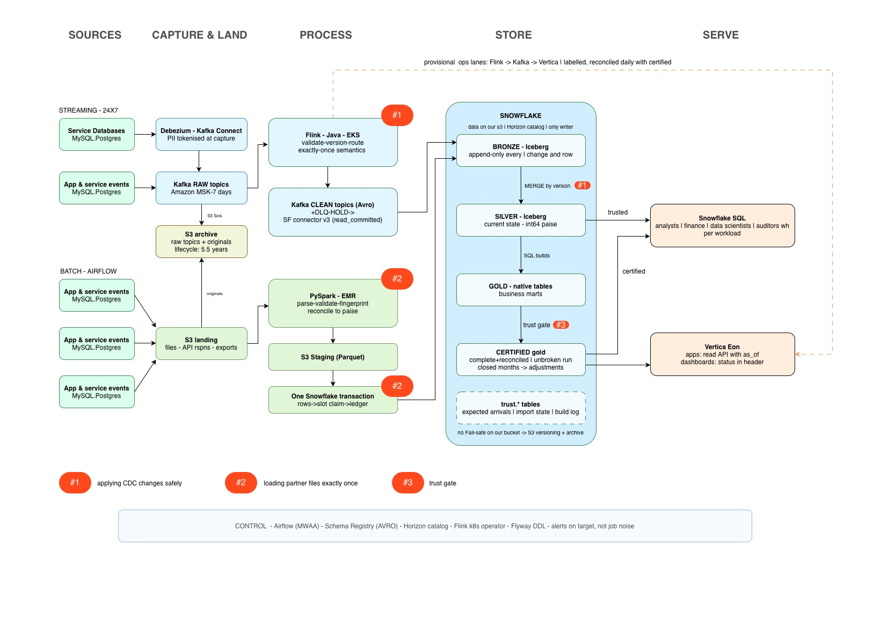

# Lakehouse data platform: take-home submission



A lakehouse platform for lending, insurance and recharge data: S3, Snowflake (with Iceberg tables) and Vertica, fed by Kafka, Flink (Java) and PySpark. It includes real code for three hard problems.

## Deliverables

Each item from the brief, and where it's answered.

| The brief asks for | Where it's answered |
|---|---|
| **A design document**, roughly 4–6 pages, in any format | [docs/design.md](docs/design.md), about 5 pages: [assumptions](docs/design.md#2-assumptions) · [architecture, what was chosen and rejected, and what it costs](docs/design.md#3-architecture) · [getting data in](docs/design.md#4-getting-data-in) · [making it trustworthy](docs/design.md#5-making-it-trustworthy) · [serving](docs/design.md#6-serving) · [living with it](docs/design.md#7-living-with-it) |
| **An architecture diagram** | [docs/architecture.jpg](docs/architecture.jpg) · [open in diagrams.net][diagram] · editable source: [docs/architecture.drawio](docs/architecture.drawio) |
| **Real code for the two or three hard parts**, roughly 200–400 lines; plumbing stubbed freely | Why these three: [design §8](docs/design.md#8-the-hard-problems). **#1** [CdcVersion.java](flink-cdc-normalizer/src/main/java/com/cdp/lakehouse/cdc/CdcVersion.java), [CdcNormalizeFunction.java](flink-cdc-normalizer/src/main/java/com/cdp/lakehouse/cdc/CdcNormalizeFunction.java), [01_cdc_apply.sql](snowflake/01_cdc_apply.sql) · **#2** [partner_file_loader.py](spark/partner_file_loader.py) · **#3** [publish_gate.py](airflow/publish_gate.py), [04_trust_gate.sql](snowflake/04_trust_gate.sql). Line counts and plumbing: [below](#where-the-guarantees-live). Reasoning, trade-offs and limits for each: [spec #1](docs/specs/01-cdc-apply.md) · [spec #2](docs/specs/02-partner-files.md) · [spec #3](docs/specs/03-trust-gate.md) |
| **A test plan** for those same parts: what you'd assert, and how each test would fail if the design were wrong | [docs/test-plan.md](docs/test-plan.md): [#1](docs/test-plan.md#1-applying-database-changes-safely) · [#2](docs/test-plan.md#2-loading-partner-files-exactly-once) · [#3](docs/test-plan.md#3-the-trust-gate) |
| **The hardest one or two as actual test code** | [tests/test_cdc_apply_property.py](tests/test_cdc_apply_property.py) (#1, property-based) · [tests/test_partner_files.py](tests/test_partner_files.py) (#2) |
| **An honesty section**: what you deliberately left out, where you're unsure, and where you used AI vs. made the decisions yourself | [design §10](docs/design.md#10-honesty-section): [what I left out](docs/design.md#101-what-i-deliberately-left-out) · [where I'm unsure](docs/design.md#102-where-im-unsure) · [AI vs. my decisions](docs/design.md#103-where-i-used-ai-vs-made-the-decisions-myself) |

## Where the guarantees live

Line counts exclude comments, blank lines and imports. "Guarantee" code is where a guarantee holds or doesn't. "Plumbing" is kept so the code is complete, and it's marked separately.

| Hard problem | Guarantee code | Lines | Plumbing |
|---|---|---|---|
| **#1 Applying database changes safely** | [CdcVersion.java](flink-cdc-normalizer/src/main/java/com/cdp/lakehouse/cdc/CdcVersion.java) (51), [CdcNormalizeFunction.java](flink-cdc-normalizer/src/main/java/com/cdp/lakehouse/cdc/CdcNormalizeFunction.java) (100), [01_cdc_apply.sql](snowflake/01_cdc_apply.sql) (70) | 221 | `CdcNormalizerJob`, `CleanRecordCodec`, `RawRecord`, `OutRecord`, `00_cdc_tables.sql` (197) |
| **#2 Loading partner files exactly once** | [partner_file_loader.py](spark/partner_file_loader.py), above the `plumbing` marker, including its small types | ~155 | Below the marker (`sha256_of`, `main`) and `02_partner_tables.sql` (~100) |
| **#3 The trust gate** | [publish_gate.py](airflow/publish_gate.py) (108), [04_trust_gate.sql](snowflake/04_trust_gate.sql) (70) | 178 | `03_trust_tables.sql` (57) |
| **Total** | | **~550** | **~355** |

This is above the brief's rough guide of 200–400 lines. The honesty section in the design doc explains why.

## Tests

| Test | Hard problem | What it proves |
|---|---|---|
| [tests/test_cdc_apply_property.py](tests/test_cdc_apply_property.py) | #1 | Property-based: silver equals the source however changes are duplicated, replayed, reordered or batched, and no version ever goes backwards |
| [tests/test_partner_files.py](tests/test_partner_files.py) | #2 | Exact paise, files quarantined whole, fingerprint; the load protocol, including two revisions racing |

## Status

| Component | Toolchain | What was actually checked |
|---|---|---|
| Flink job (Java) | Flink 1.20.0, Java 17, `flink-connector-kafka` 3.4.0-1.20, Confluent serializer 7.9.10 | **Compiles and packages:** `mvn -f flink-cdc-normalizer/pom.xml package` |
| PySpark loader, publish gate, tests | Python 3.11, Spark 3.5 | Syntax-checked only; **not run** |
| Snowflake SQL | — | **Not executed** (no Snowflake account in this environment) |

## Layout

```
flink-cdc-normalizer/   Flink job (Java): raw Debezium topics → clean, versioned topics   (#1)
spark/                  PySpark partner-file loader                                       (#2)
airflow/                Publish gate for certified tables                                 (#3)
snowflake/              00–01 CDC apply (#1) · 02 partner files (#2) · 03–04 trust gate (#3)
tests/                  The two real tests, and requirements.txt
docs/                   Design, diagram, specs, test plan, decision log
```

[diagram]: https://viewer.diagrams.net/?tags=%7B%7D&lightbox=1&highlight=333333&edit=_blank&layers=1&nav=1&title=high-level-architecture&dark=0#R%3Cmxfile%3E%3Cdiagram%20name%3D%22Page-1%22%20id%3D%22CDPw_TBGP9R30SD3wzxQ%22%3E7V1rc%2BI2F%2F41zGTfGRjfLx%2B57qabbLKQ7rbvl46wFfDG2K5sQuivr%2BQbtmzAgGUgzc60AdkWtp5HR%2Bem45bYX7x9RsCb37smtFsCZ761xEFLEASOF%2FAf0rKOWnhejltmyDLjtk3DxPoHxo1c3Lq0TOjnTgxc1w4sL99ouI4DjSDXBhByV%2FnTnl07%2F6semMFCw8QAdrH1p2UG86hVE9RN%2BxdozebJL%2FOKHh1ZgOTk%2BEn8OTDdVaZJHLbEPnLdIPq0eOtDm4xeMi7RdaMtR9MbQ9AJqlwgGE%2Fyd%2F7x1w84Wn39LeDvn6eDtl7STdzkB%2BtkEJC7dExI%2BuFbYm81twI48YBBjq4w7rhtHizs%2BLAfIPcF9l3bReHVojbsqSN8V71ny7Yz7SN11A3bo997BfYy%2Fr24AaIAvmXuKX6uz9BdwACt8SnzzNAr8TivNjDxvBY3JoRMwIjpqMvxdxDTZJb2vRlJ%2FCEezAMGVlJrH1gPIgvfHETkFMuZ4WZdKg7rgB8Ow2EFyIjnE55MJbiIPU2Vahx%2FqQiAQI2%2FJubHn9dZjX%2F9vM4Os00eu20C9HJDRrw3Gg1xf%2FhOxX4ff1Y%2BlY23xOuKrJWPt2Ljm%2BxN8YcZ%2BTCB6NXC9yFwAxCAKfCxCIzPwaORnpa0mdZr0nS%2Fnny%2F6zy6fjBDuYsy59Q2vaQ8ujyfRzedbbWjK14eurtmUwGlAuBdz2uR0VLAgtxY9H%2FyOCkR4Ct%2B1J0soEG%2BaG6IzLghNciNoTBSsKxNuIGZUj7zOU3qVZv5AziF%2F1jLBT6tjf%2F7Cp5fAP7bj9WbakLg8fY21JNeoGP5%2BCnxKAdERwJesESQMfAqteTqTQkF%2BRqB3yUUEvDH3Z8hnJ5lnCYAugvwj%2Bvgvu4nX9sqUcvBmrUc2EMHdnJAaZAOI34kD7p76aDJiiqIx9JhIoY2jTG3XuFJNEBgleETHn%2By0rjImlkOsLfyodCNbT1DY22QocSPzskdmcAKATozpSRmlKqk0%2BOnC%2FK8KaNVnhuO60CKYHETwERz8FcD%2FyLE7T0yfha2T7vxgYVlmuSnexsqc7sY9uw6Qe6Glb%2BXbnKg7YcGA4FT894i2OPDORZOLOclA3LU5wkoi0WUlTzIokrJDU1mpT%2FEPwTNgmegCLu7RAbc0ZlWoAfpdhJ%2FdVEwd2cunnXDTSsF5OacO9f1Ykb9gkGwjo07sAzcPN%2FwXaL1H%2FH14Zc%2FyZeOLCtJw%2BAte3iwzn57TOzMHJUCgGYw2GVxKSWcKwMeQRsERIblfDV1w6g1qQ0Q8a%2FuFf8qpyuKdJL4t4FjEtP%2FFPGPn4No%2F6F%2B2X0kmiLyPSdpgW8eplwqwqdoX%2F%2FNCHWFZyXU9QaJ8mFLsrAlZWYLfvJDH%2BS4WnKwExz8BfoYP8hxEDlUjhk5hCu2FSZP42H3%2Fvbb51gnEKQ%2F1Lr0el6kIOHykDAMCVTyGl8oJL3uU%2F9LorTdjkd3Dz%2BbQkRih8gF%2BmpPk6AjO7SMQ5h%2BA68g%2Fjj8OjlJZuK7sEwQwDZG27dcp43HJNjqyC1cDt%2BAEdjrtuuEQtyHC%2BAEkTMxkvHO1PfqVfH1Is8EShjLFM%2FYeYal2BisxaTn5QJDz2jTC%2FIek75VzXqXhBK%2Bn8965y%2FQmX%2BaZEgjOXfD7rdWxv16031F7qeTxENL6A3uvre%2FPNwN2umcPqyLCX7%2BJIkGPzB%2BPOJuuEEQmH8Z7mJhBQE0P51XQIjMsjUS39X78RY9rvGtoWQpGt6PTyIY7srHi0%2ByCj1bzgwiD1lOGpHc7ycqhiEg5pth2TCcDeHoW36d0ckjKMbQlVB%2FQtAlOCQnAZiFDknu5hGgv5cwOEiUHYGqfDiqaWpS%2Fai%2BOzfzg0Pm48RxV882eAnnJgKOjxVIi4SOTwk7uiufWp582w0TE2xgLahDNlGq0Hl5ozKTBglJKmmkGUXTMbskqZVYlDbwfcvIcyevZm50xk6qJf6Z1SdPUxmrxnvKQCjVIjPI7Frp4194dMPlZxMglPNznvb7RYp9fNUGvkJHkpDvSFaojqKBKXQU8iB97BOoIRxAjX3GSomtUguFuD0Ugm9WkLkMf0uJhz9vLiJfrpt2EuUsoT2KVWknapSyqzVMO%2FGMEmkfnSpSQxIvihu6oncUhUv%2F8XmAjxVQe7qV9I6e%2Fdcsi6QahVd9bMv7TPa5TBLhxWdE10aQnSS8pIsiqEAl1Qi0p7cqJemORLFh4SU3KryaotOl0ESm0MUiJtnGdTBT6PzPkr5Yk0X5IEtzZFFEvSPy9ZClrC%2FWZFHPR5bzLVPaRVNKlogCVA%2BlyvpiTalDolH1Umqf5f%2BfpZRKKyzH8knVuY4oNcon8RBfEnOHwREMSrna5jocp1ILpiTtI%2B0pSctnVcjxuIJ15gSPUMTfzlqJ9hHEv7DVlUWdLyhaR1coDkY3saUDWvM71mYtxPobdqqJhzjVrsdZdiHSlN6cIdC%2Bq8pOMNqOpB3wrGnSxNJ8UdAp%2FEb%2FOdVzXtYXHXljDaD%2BAaCgHOvGKemrEAJjDKBUCa8LTdJMopWn7rEr24t5hj12Mq0U15eQJ1RBua7NuRIJlTNO7%2BqNH779f9iK0m1uDTiF6LRdWsDzsFRqu45NgIQYbPK3peKn4Iw5cGYkNA8ckwgVLLiYptHTcXKNUgt3iq3TNnHXGU9IwkPNZm5WXC0q51WWi25eoLY2SPQqzlpwN1mTpZEpPbm9%2BzEc1ziljSUKx4aMCCDp22HPGA%2FC8tqz346Yx4WYc30Cv8lM%2F0bY8fnhbhAj6EQTl7gbpvbuSk17OTJd%2BpYDfZIYvAAoYLw%2Fah8hZGab55QjgzDny7RXa8q0V4SGVgSOjp4ca5XzAp1P2XBuinKkWX6li%2FuhbkGel7kOJ%2BYhkvWOzO%2BGteQySUqbdrFh%2F2V7HItFcpL7PZaetOrTsNNBanKzSiOLW384frod3ZINx9yMlEw9Se1xF54Nib6zSfk3U1tm6UzJrZOqVGjpVO%2FUdqPKZgtsF8%2Fj4hX5nS8cMH8t%2FWBB7Vg%2BwzLKLv9carTKVSn1TODP077Jl0cQBBARv4lGfBz1szNAGNbO%2F%2BpRuOCbB40gKpKHkPUael1ibloLUgslo69HzdOlRaYEZ7uz8%2FKqELWsj1eH%2BFH35vGdpwrSKZFIRrpf%2Fbssj1IYNLoMQryCbVth6fMFXaYYtmutVxXKqKBdylUXeo3KtS7sB2S8zic%2Fd5FBxIrEaiooUVPcuNBR05Cfc5%2FOVUEeZaXnwCro4YdkuJfksG9zSrDmgPDBgaM5IKtMONB0XFmuZOK9k7Akz22JSzpkl%2FYIWHbbB89EHw6LCWNAQ6XYeIFBqR0WbhSOK5dEe4WjkrPFWrYsgpzp2pMqM%2Fn9fSqz8jZyJePsQkkTGlnE%2FA8tn3qgoOLNOh1vZofEf6ly79bpO%2Fl%2Bl1ivrDMLqPd%2B6JQJINHpf%2FUhXWlD%2FntH%2Bn44%2FkySEabrjeRljDgv7Ia8sCWsPsgrVXB975CbIAD5Fdkny27ksfriIiuq%2FG%2Fg00K%2FVXwkzi9ZISvIVVtgQZG9aSTs3gXAvQOKbBITvj38HN11vw7LHZ9s1mrK9yIwq5ypsC2rSvzYo%2BFwMKg21Jk6KOHyWen9K8AB9toPNo7kZ8sBUe296Hs8WX3Dwo9oZc8ES9MKXPIKBW41J6NAZiW3ctGL7QKzRnezVjI%2Fk3fXbQJr1N5yZvkhSVD8nKDvCjn8iOYuvnB4YhUc4JE3F3ZD%2B5sAGpdgX1nBPBzYv9znyn2RaMvUBciMeyRhiiWhjuWEaAOz1go6x1BGYSfTr3nZD60rEnRiIqx5Xmhq4qrXvLIa5LpniyEOch4HdqV01To3ASa74k7eBZjf0ZSG23bH3tIkrGo75gvB5dFIV%2BVeq1JkOnrO%2BnK2LmKbYCpzY9YlBZ63JtDI8okXKErugn0BQfr%2Bjo0TFO%2Bj4bojaiW15UKln4fcV4t4BgB5ztRrG9eCdj2iSNjAgbFykSltTfl3k9K2xSMbtSnSbm0wxaNK5G0%2FnBiZbCATWJElGilCtYtmmdJUVFHu5B3BPDOTRr3myvMZXbjEPWFEvxrqs7PpjRqVp%2BQ2fz%2BVeisOdXsIW32aD7%2BP%2B8NsdfW856IxA5mX1A5dOZAZnypl03%2Fw6Qg%2B9buPT7%2BPh1mBmL4G5a77bXAGoqVvxEiLbTXItPcQ97xMpj2OH7DgugDJJTfJp2sOiV42nyZPD%2BPh%2BdmkCw2y6T0E%2By6UTcPxjwtgEy%2FyQkdtik71vwoSICNOUJa5VolPWtL5%2FjbybWVM5VihEoPLUWwSSDoToVH2wzZCkfJS9YUFpf2QUymfGjPfZdLxB945vIVm8ZZ4vSm8648svge8xWbxTjetsMf7mr1zwPPsdZQt2R9sin4QpxxJvrTXda24tHnJKzKFD6s3rWvX7BYj4fgIHnz7gROG6ZM3a8fv22uR9BqjtuzJNOUiEZwqLTiZAXXN%2FqYGEllVvbEpU%2F9W4%2FewhDWsoqqUisrrzPCuf3%2Fve8C7YRWVxltmFinS6n9L3AfeJ%2BPN7jXhWv3vj3sPeNcqz5P9Ptk9QZTKyxXeX6KxAvzDx8TcBq0COGWEyjorwPVKTqYL1Z0TVHwPOKVsONJN3X%2F49jR%2BILuR6LST8P32Fnq2SU1L7ub%2BZ7f7qRWVWZsYc7gguSRjOLP8CPab7o%2FxQ3JC2S4H0p5krrxoxDhzPYhA9I7j6OB6FWZXDQZ3cROwYVh5LdpMESeHhc%2FjhK%2Br%2FOVOw8%2F5en3RGNW8jUrN85Z%2ByaGuHK544q%2FIJWikxz5jds3vXROSM%2F4F%3C%2Fdiagram%3E%3C%2Fmxfile%3E
