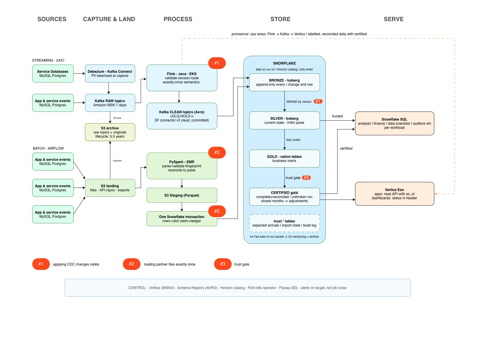

# Lakehouse Data Platform for Lending, Insurance and Recharge

**Data Engineer Expert take-home · Manojit Roy · 27 September 2026**

Code map and line counts: `README.md`. Full specs for the hard problems: `docs/specs/`.

## 1. Summary

The platform lands data from service databases, event streams, partner files, third-party APIs and Ops spreadsheets in a lakehouse on S3. Snowflake is the single writer and catalog, and the data is served through Snowflake and Vertica.

At these volumes, throughput is not the hard part. About 10 MB/s of events and ~500M file rows a day fit a small Kafka cluster and a modest Spark job. The hard part is that every source is unreliable in its own way, and the failures are silent. A replayed CDC event, a re-sent partner file or a half-loaded day doesn't crash anything; it makes a finance number wrong.

So I went deep on three places where a weak source guarantee must become a strong one:

1. **Applying database changes safely:** silver equals the source, however changes are duplicated, replayed, reordered or batched.
2. **Loading partner files exactly once:** all or nothing, and only if the file reconciles to the paise. A correction replaces the old version in one step.
3. **The trust gate:** a finance table shows a date only when every expected input has arrived and reconciled. Closed months never change.

#1 and #2 make data correct as it enters; #3 decides when it can be trusted.

## 2. Assumptions

| # | Open point | Assumption |
|---|---|---|
| A1 | Cloud | AWS Mumbai; no data leaves India (RBI and IRDAI localisation). DR copies the data to AWS Hyderabad. |
| A2 | Identity | One `customer_id` across the three businesses |
| A3 | Service databases | MySQL/Postgres, read with log-based CDC and full row images; changes are applied in Snowflake |
| A4 | Latency | Finance: next day, final. Ops: minutes. Apps: sub-second, from a serving store, never from the lake. |
| A5 | Correct vs available | Finance: late beats wrong. Analytics: stale but labelled beats blocked. |
| A6 | Lending | Loans sit on partner lenders' books, so their files are the truth for balances |
| A7 | Partner files | Mostly next day, with resends and corrections; most send a trailer (row count + paise total) |
| A8 | Ownership | The platform team owns pipelines and reporting; finance approves certified metric definitions |

## 3. Architecture

- **Streaming (24×7):**
  - Debezium and app producers write to raw Kafka topics.
  - A Flink job (Java, on Kubernetes) validates, versions and routes each record to a clean, dead-letter or HOLD topic, using exactly-once transactions.
  - Snowflake's Kafka connector v3 appends clean records to bronze.
  - Raw topics are archived to S3 before Flink touches them.
- **Batch (Airflow):** files, API responses and spreadsheet exports land in S3. PySpark on EMR validates and reconciles each file, and one Snowflake transaction loads it.
- **Snowflake:**
  - Streams and tasks MERGE bronze into silver, and SQL builds gold. The trust gate certifies it.
  - Vertica Eon serves apps and dashboards from certified gold. It also takes a provisional ops lane straight from Flink, clearly labelled as provisional.

| Layer | Holds | Where |
|---|---|---|
| Raw | Bytes as received | Kafka (7 days); S3 archive (5.5 years, moved to Glacier by age) |
| Bronze | Every change, event and file row, append-only | Snowflake-managed Iceberg in our S3 bucket |
| Silver | Current state per entity; amounts in int64 paise | Snowflake-managed Iceberg |
| Gold | Business marts, including certified finance tables | Native Snowflake tables |
| Serving | Low-latency copies | Vertica Eon |

| Decision | Chosen | Rejected, and why | Cost |
|---|---|---|---|
| Format and catalog | Snowflake-managed Iceberg; Snowflake is the only writer | **Open Catalog or Glue:** on tables managed outside Snowflake, Snowflake allows only autocommit and no standard streams, and #1 and #2 need both. **Native tables only:** the data leaves our bucket. | No Fail-safe on our bucket (S3 versioning and the archive instead); compaction is billed |
| Gold | Native tables | **Iceberg:** gold is small and heavily audited, and native tables give zero-copy clones plus Fail-safe | Gold lives only in Snowflake (it can be rebuilt) |
| CDC capture | Debezium | **Polling `updated_at`:** misses deletes. **Flink CDC:** no durable log. **AWS DMS:** JSON only. | We run Kafka Connect and watch log retention |
| Stream → Snowflake | Flink exactly-once → connector v3 | **v4:** no Iceberg schema evolution. **Flink writing Iceberg:** a second writer. | ~1 min latency; a v4 migration later |
| Batch → Snowflake | PySpark → S3 staging → one transaction | **Spark writing Iceberg through Horizon:** a second writer, and GA only since May 2026 | An extra hop; two compute bills |
| Serving | Snowflake + Vertica | **Apps on Snowflake:** warehouses always on. **A key-value store:** outside the chosen stack. | A second copy to keep in sync |

Leaving Snowflake means registering the Iceberg tables in another catalog and rebuilding gold.

**What the stack buys:**
- Kafka and Flink: per-key ordering and transactional exactly-once.
- Debezium: deletes and every intermediate state.
- Snowflake-managed Iceberg: an open format, with transactions, streams and managed compaction.
- EMR: heavy parsing stays off Snowflake credits.
- Vertica: cheap sub-second dashboards.

## 4. Getting data in

| Source | What it guarantees | How it misbehaves | What we do |
|---|---|---|---|
| Service databases (CDC) | Every change including deletes, in per-key commit order, replayable | Duplicates after restarts; re-snapshots; log purged while the connector is down; schema changes; partial rows | Version-guarded apply (#1). Alert before lag reaches log retention. Schema changes that aren't additions go to HOLD. |
| Event streams | At-least-once, per-partition order | Retry duplicates; events days late; wrong device clocks; invalid payloads | Dedup by `event_id`; keep event time and receive time; invalid events to a dead-letter topic; Schema Registry checks |
| Partner files | Nothing; at best a trailer | Renamed resends, corrections, stale revisions, truncation, rounding, ambiguous dates | Exactly-once loader (#2) |
| Third-party APIs | Rate limits; rarely a change feed | Throttling, partial pages, silent schema changes | "Changed since" pulls with an overlapping window, then dedup; every raw response kept |
| Ops spreadsheets | Nothing | A wrong rate silently changes finance numbers | Maker-checker; validation; history with effective dates |

Across all sources:
- One bad source never blocks the others.
- Nothing is silently dropped or partly loaded.
- Every problem shows up in the import state behind the trust gate (#3).

**Event dedup.** A retry reuses its `event_id`. Two real actions never share one, because producers generate a random UUID per action and never derive it from the content. Dedup keys on (source, `event_id`) in two layers:
- **Flink** keeps a hash of each event's content for about 24 hours:
  - same ID and same hash → a retry, which is dropped
  - same ID with different content → a producer bug, which goes to HOLD rather than being dropped
- **Silver's MERGE** inserts only IDs it hasn't seen, searching a single day's partition, because a retry carries the same event time. This catches phones replaying days later, and Flink state resets.

Money never depends on event dedup: financial records come from CDC (#1), keyed by transaction.

**Exactly-once, end to end.** Kafka transactions never lose data, but their commit markers leave gaps in offsets, and Snowflake's docs warn that the connector expects sequential offsets. Four guards make the guarantee hold:
1. The connector reads with `read_committed`.
2. The transaction timeout outlasts the worst-case recovery.
3. A pre-production test proves the pinned connector version handles transactional topics.
4. The apply in #1 stays idempotent, because Debezium is at-least-once anyway.

## 5. Making it trustworthy

- **Correct.** Four kinds of check:
  - contracts: schema, required fields, whole paise
  - every record accounted for: per raw offset range, in = clean + DLQ + HOLD + filtered
  - reconciliation: file against trailer; silver against the source replica; our records against partner settlements; bronze → silver → gold totals
  - business rules

  Certified tables block on any failure; trusted tables publish with a warning.
- **Current.** Freshness is not completeness. Every input is an expected unit with a due time. "Complete through" is the end of the unbroken run of complete dates, the rule I use in production with an import-state table in Vertica (#3). Business dates are IST; timestamps are UTC.
- **Means what they think:**
  - one registry definition per metric, with an owner, a finance approver, a version, and maker-checker changes
  - naming enforced in CI: `_paise` integers, `_utc` timestamps, `business_date_ist`
  - `certified`, `trusted` and `raw` tiers visible as tags
  - column comments kept in Snowflake
- **Traceable.** Any reported number follows one chain: the month-close clone (what was reported) → the build log (inputs as of, git SHA, metric versions) → load IDs and source positions → the raw archive.
- **Personal data.** Tokenised at capture, by a Debezium transform on the customer and KYC tables and by the file parser.
  - Tokens are random IDs from a security-owned vault, not hashes. Anyone holding a hashing key could recompute the token for every phone number.
  - Erasure deletes the token-to-value mapping. Records under PMLA retention wait until retention ends, which the DPDP Act allows.
  - Original partner files stay in a restricted part of the archive as legal evidence.
  - Aadhaar numbers never enter the platform.

## 6. Serving

| Consumer | Gets | Freshness | Guarantee |
|---|---|---|---|
| Analysts | Silver and analytics gold in Snowflake | Minutes | Trusted: checked, may be corrected |
| Finance | Certified gold by IST business date; mismatch reports; month-close clones; adjustments | Next day by 10:00 IST | Reconciled to the paise; closed months never change |
| Applications | A read API over Vertica: summaries, segments, scores | ~1 hour, with `as_of` on each response | Derived data only, never balances |
| Data scientists | Feature tables with history; Spark reads Iceberg | Same as silver and gold | A training row sees only data committed before its time |
| Auditors | A read-only role over clones, build log, import state and access history | As reported | Every number traces back to the raw bytes |
| Ops | Vertica dashboards: the provisional lane plus certified KPIs | ~1–2 min | Labelled; the two lanes reconciled daily |

- Each workload has its own warehouse with a spending limit.
- Roles are set per business line.
- Tokens are turned back into personal data only through the vault, and every lookup is logged.

## 7. Living with it

**Targets** (alerts fire on these):
- silver under 10 min behind the sources, and events under 2 min to bronze (both p95)
- the finance day certified by 10:00 IST, if files arrived by 06:00
- the Vertica certified lane under 60 min behind gold

**Early warnings:** connector lag against log retention; replication slot size; checkpoint duration; open-transaction age; dead-letter and quarantine rates.

| Failure | Recovery | Data impact |
|---|---|---|
| Flink JobManager dies | Kubernetes HA restores every job from the last checkpoint | None, unless recovery outlasts the transaction timeout. Then the audit gap shows it, and the range is replayed from raw. |
| A bug in a Flink job | Fix it and replay from raw; the version guard makes replays safe | None after the replay |
| Debezium down too long (the alert fires first) | Re-snapshot under a new epoch, then sweep | Stale tables until it finishes |
| A partner file is bad or late | Quarantine and notify; the day stays uncertified, with the reason shown | None: publishing is blocked |
| The Mumbai region is lost | S3 data is replicated to Hyderabad; the AWS side is rebuilt from code | Snowflake has only one Indian region, so it stays down until Mumbai recovers. This is a stated, accepted risk. |

**Recovery targets (proposed):**
- **RPO ≤ 15 minutes** for S3 data. S3 Replication Time Control copies 99.99% of objects within 15 minutes.
- **RTO of a few hours** for the AWS side, rebuilt from code.
- **Snowflake's RTO** is however long the Mumbai region takes to recover.

**Cost:**
- **Snowflake credits** are the largest line (MERGE cadence, builds, queries). Controls: warehouses per workload, and task cadence set by the targets.
- **S3:** by year 5, bronze plus silver is ≈ 360 TB, about $9k/month at list price. Keeping bronze in Snowflake for only 13 months cuts that by about 40%.
- **Streaming** is small and flat; **EMR** uses Spot instances; **Vertica** holds serving-sized data only.

**Where it breaks first:**
1. **The streaming chain.** Transactions, one shared JobManager and a connector that dislikes offset gaps are tightly linked. Escape hatch: the apply is idempotent, so Flink can drop to at-least-once without a redesign.
2. **MERGE cost on tables that change a lot,** as silver grows. Fix: a current-state table plus a history table.
3. **The central team (A8) as a bottleneck.** Fix: partner formats defined as configuration; later, gold owned by domain teams.
4. **Vertica per-customer lookups.** Fix: a cache, then a key-value store.

## 8. The hard problems

Each has a full spec in `docs/specs/`. Line counts exclude comments, blank lines and imports.

### 8.1 Applying database changes safely (#1)

**Guarantee.** Each silver row equals the source row at the highest version seen for its key, however changes are duplicated, replayed, reordered or batched. Silver never moves backwards, and deleted rows never come back.

**Why it's hard.** "Newer" is easy to get wrong:
- Timestamps skew and tie.
- Kafka offsets change when Debezium re-sends.
- On Postgres, `source.lsn` isn't monotonic across overlapping transactions. A transaction still open during a snapshot has LSNs below the snapshot point but commits after it, so a naive comparison loses its update. Debezium's fix, a commit LSN, is an unmerged pull request.

**Design.** Each change gets one version, computed in Flink: `epoch × 10^27 + phase × 10^26 + position × 10^6 + row` (NUMBER(38,0)), with the raw offset as tie-breaker.
- **Newer wins,** and equal or older is ignored. Each batch keeps one change per key.
- **Deletes leave tombstones,** so a late update can't bring a deleted row back.
- **Within an epoch, a snapshot row loses to any live change.** The epoch's live changes form a complete, ordered tail of the log. This fixes the open-transaction case without a commit LSN.
- **Every snapshot starts a new epoch.** A sweep afterwards removes what the snapshot didn't see, and raises a per-table floor so the old timeline can't return. If the sweep runs too early, it heals itself.
- **On a MySQL server change, Flink holds the records** instead of guessing.

**Code (221 lines):** `CdcVersion.java` (51), `CdcNormalizeFunction.java` (100), `snowflake/01_cdc_apply.sql` (70). It builds against Flink 1.20.0 on Java 17.

**Tested by** a Hypothesis property test against Snowflake, which runs the MERGE text straight from the SQL file:
- **Inputs:** random histories with transactions still open during a snapshot and an epoch change. The changes are duplicated, replayed, shuffled, batched, and some are lost.
- **Assertions:** silver equals the source, and no version ever goes backwards.

**Limits:**
- Tables converge independently, so a transaction spanning several tables can be seen half-applied.
- Epoch changes are a runbook step.

### 8.2 Loading partner files exactly once (#2)

**Guarantee.** Each file becomes visible exactly once, all at once, and only if it matches its trailer to the paise. A correction replaces its predecessor in one step.

**Why it's hard.** Renamed resends, corrections, old revisions arriving late, truncated uploads and concurrent loaders. And a plain decimal cast rounds `10.005` to `10.01` without an error.

**Design.**
- **Identity comes from content:** the SHA-256 of the decompressed bytes, plus the header's slot (partner, feed, business date, sequence) and revision. A data fingerprint (row count + paise total + an order-independent row checksum) makes a re-export a duplicate rather than a conflict.
- **Append-only rows, plus a per-slot "active load" pointer.** One transaction:
  1. inserts the rows, checked against the reconciled count
  2. claims the slot with a MERGE, which succeeds only if the slot is empty or holds an older revision
  3. writes the ledger

  Snowflake runs MERGEs on a table one at a time, so exactly one of two racing loaders wins.
- **Zero tolerance:** one bad row, a stale revision, or the same revision with different data quarantines the file. A file with no trailer is unreconciled and can't certify a day.
- **Money:** a pattern check (at most two decimals) runs before the exact decimal cast. Indian digit grouping is handled, and totals are 64-bit sums under ANSI mode. The unit (rupees, or whole paise) comes from each partner's agreement.

**Code (~155 lines):** `spark/partner_file_loader.py`.

**Tested by** two sets of tests:
- **Local Spark:** exact paise; `10.005` quarantined; truncation; a one-paisa mismatch; the date window; duplicates; the fingerprint.
- **Snowflake protocol:** resend, re-export, conflict, correction, stale revision; and two revisions racing, where v2 ends up active either way and never alongside v1.

**Limits:**
- Loads queue briefly at the claim step.
- The partner's trailer is trusted, so #3's cross-source reconciliation is the backstop.

### 8.3 The trust gate (#3)

**Guarantee.** A certified table shows a date only when every expected input has arrived and reconciled, in an unbroken run. Before month close, changed inputs rebuild the date; after close, they become an adjustment in the open period. Closed months never change.

**Design.** The gate generalises the import-state table I run in production (freshness = latest loaded hour; completeness = end of the unbroken run).
- **Every check is an expected unit with a due time:**
  - partner file slots
  - CDC days: applied past midnight IST and reconciled with the source replica
  - stream hours: closed, with every record accounted for
  - cross-source reconciliation

  The latest meaningful arrival decides each unit.
- **The gate walks dates in order:**
  - A certified date whose inputs changed is rebuilt if its month is open, or adjusted if it's closed. The adjustment is netted against adjustments already booked.
  - New dates are certified while they're complete, stopping at the first gap.
- **One transaction per date,** with an exact check that gold equals silver. `inputs_as_of` moves in the same transaction, so a re-run does nothing.
- **Month close** refuses while any date is uncertified, then clones the table.
- **A blocked correction for a certified date** leaves its numbers standing, shown as an open item.

**Code (178 lines):** `airflow/publish_gate.py` (108) and `snowflake/04_trust_gate.sql` (70).

**Tested by** a written plan covering the unbroken run, missing vs late inputs, loaded ≠ reconciled, a correction before and after close, an idempotent re-run, the totals check, and a lost transaction.

**Limits:**
- An old missing file blocks later dates until someone chases it or approves a waiver. The waiver is described but not coded.
- Expected arrivals are only as good as the registered calendars.

## 9. Test plan

`docs/test-plan.md` lists every test, what it asserts, and how it would fail if the design were wrong. Two are real code:
- `tests/test_cdc_apply_property.py` (#1)
- `tests/test_partner_files.py` (#2)

## 10. Honesty section

**Left out:**
- Identity resolution (A2).
- Cross-table consistency for near-real-time readers.
- The feature store.
- The tokenisation vault's own design.
- Airflow DAGs, connector configs, infrastructure code, the Vertica API, generating expected arrivals, and the waiver workflow: described, not built.
- A full cost model; only S3 is computed.

**Unsure:**
- Whether connector v3 handles the offset gaps from transactional topics (a test is planned).
- Details to verify when pinning versions: Debezium transform field names, MySQL `source.pos` semantics, and a few Snowflake behaviours listed in the specs.
- The regulatory points are my reading, not legal advice.

**Actually run:** the Java compiles against Flink 1.20.0. The SQL and Python have not been executed; the Python is syntax-checked only.

**Size:** about 550 lines of guarantee code, against the brief's rough 200–400, plus about 355 lines of plumbing kept so the job compiles. The README counts the two separately.

**AI vs my decisions.** I used Claude (Anthropic's model) as a design partner, and to draft the specs, code and this document. The process:
- Claude proposed options with trade-offs, and I made the calls.
- I kept an internal log of every decision, recording who proposed it and who decided it. This section summarises it.
- I approved each hard problem's spec before its code was written.
- Vendor facts were checked against current documentation.
- I came up with the high-level architecture (the stack, and how data flows through it) and drew the final diagram myself in draw.io, starting from the draft Claude produced from our discussion.

The split:
- **I decided:**
  - the high-level architecture: S3, Snowflake (with Iceberg tables) and Vertica; Flink in Java on Kubernetes, reading from and writing to Kafka; Kafka Connect sinks into the S3 archive and into Snowflake through connector v3; batch in PySpark (Python 3.11) on EMR
  - Flink on a Kubernetes session cluster with JobManager HA and 30–60 s checkpoints
  - exactly-once in Flink and Kafka (Claude had recommended at-least-once plus an idempotent apply)
  - connector v3 over v4 (Claude confirmed that v4 lacks Iceberg schema evolution)
  - the 5.5-year archive
  - EMR for batch
  - central ownership
  - choosing hard problems I've handled in production
- **Claude proposed, and I accepted:**
  - the sizing framing
  - within that architecture: single-writer Snowflake-managed Iceberg, native gold, Debezium, and the two Vertica lanes
  - the trust model, and tokenisation at capture
  - the CDC version design
  - the data fingerprint
  - the trust gate's structure
  - the "breaks first" ranking
- **Corrections went both ways:**
  - Claude corrected my belief that exactly-once leaves no offset gaps.
  - My direction, Snowflake-managed Iceberg, proved better supported than Claude's first recommendation, Open Catalog.
  - Claude corrected its own archive advice, which led to tokenising at capture.
  - I first proposed Snowflake as the service database, and switched to MySQL/Postgres after discussion.

**Sources:**
- Snowflake docs: Kafka connector v4, and v3 with Iceberg; Snowpipe Streaming classic; Iceberg tables; CREATE STREAM; Horizon external engines; supported regions
- Debezium PR #7764
- Flink Kafka connector docs
